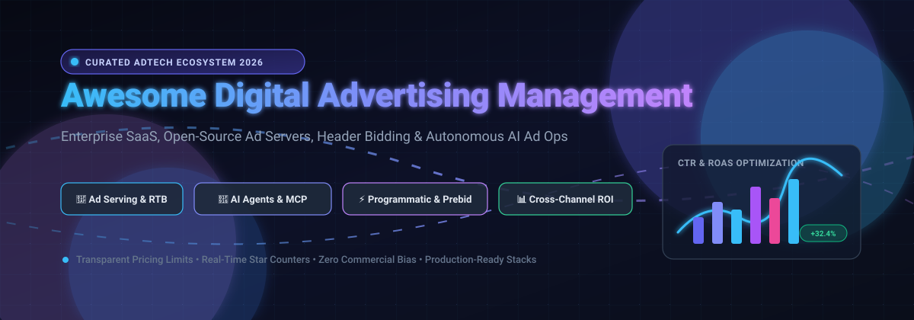

# Awesome Digital Advertising Management 🚀

 

 

**A curated, production-focused directory of leading SaaS platforms, open-source ad servers, real-time bidding (RTB) frameworks, and AI-driven ad management systems.**

*Explore transparent pricing tiers, free tier constraints, and real-time open-source stargazers to choose the optimal digital advertising stack.*

[🌟 Star on GitHub](https://github.com/ishandutta2007/Awesome-Digital-Advertising-Management) • [📖 Table of Contents](#-table-of-contents) • [🤝 Contributing](#-how-to-contribute) • [☕ Support](#-support)

---

## 📑 Table of Contents

- [📊 Sector Overview & Market Dynamics](#-sector-overview--market-dynamics)
- [🏢 SaaS & Hosted Advertising Platforms](#-saas--hosted-advertising-platforms)
- [💻 Open-Source AdTech & GitHub Repositories](#-open-source-adtech--github-repositories)
- [📈 Star History](#-star-history)
- [🤝 How to Contribute](#-how-to-contribute)
- [☕ Support](#-support)
- [⚠️ Disclaimer](#-disclaimer)

---

## 📊 Sector Overview & Market Dynamics

The global digital advertising management sector represents a **$600B–$740B+ market** (projected to exceed $1.2 Trillion by 2030, growing at ~9-11% CAGR). The market exhibits a distinct dual dynamic:

- **Infrastructure Layer (Highly Concentrated / Oligopoly):** Dominated by "walled-garden" hyperscalers—**Google (Alphabet)**, **Meta Platforms**, and **Amazon Ads**—which command over 60% of total global digital ad investments due to proprietary identity data, proprietary ad exchanges, and captive inventory (Search, YouTube, Instagram, Prime Video).
- **Execution & Tooling Layer (Moderately to Highly Fragmented):** Marketers face severe fragmentation across DSPs, SSPs, retail media networks (Walmart, Target), and emerging AI agent workflows. Independent SaaS platforms (Marin, Skai, Smartly) and self-hosted open-source stacks (Prebid, Revive, openadserver) thrive by providing multi-channel attribution, automated bidding, and transparent ad-serving infrastructure outside vendor lock-in.

---

## 🏢 SaaS & Hosted Advertising Platforms

| Product | Company Size (Valuation / Revenue) | Starting Pricing Tier | Free Tier / Free Trial Limits | Key Focus & Capabilities |
| :--- | :--- | :--- | :--- | :--- |
| **Google Ads** | ~$2.1T Market Cap / $260B+ Ad Revenue (Alphabet) | $0 platform fee; pay-per-click/impression auction ($5/day recommended starter spend) | Free account setup; eligible new accounts receive a $500 matched ad spend credit (must spend $500 in 60 days; credit expires in 60 days) | 🎯 Search, display, video (YouTube), shopping, and Performance Max campaigns backed by global search intent and automated Smart Bidding. |
| **Meta Ads Manager** | ~$1.5T Market Cap / $160B+ Ad Revenue (Meta Platforms) | $0 platform fee; pay-per-impression auction ($1–$5/day minimum ad spend depending on objective) | Free access to dashboard and Audience Insights; no permanent free media spend (occasional $10–$50 partner credits upon sign-up) | 📱 Facebook, Instagram, and WhatsApp social advertising with algorithmic interest and lookalike demographic targeting. |
| **HubSpot Ad Management** | ~$32B Market Cap / $2.6B Revenue (HubSpot) | Free plan available; Starter at $15/seat/month; advanced ad management in Marketing Hub Pro at $890/month | Free forever plan connects up to 2 ad accounts across Google, Meta, or LinkedIn with basic audience tracking and contact sync | 🔄 Native CRM-driven ad campaign management tying ad spend directly to closed-won revenue, deals, and inbound leads. |
| **Perpetua** | $835M Acquisition (Division of Omnicom / Flywheel) | $695/month (Essentials plan covering up to $10,000 monthly ad spend) | No self-serve free trial; offers custom 1-on-1 personalized platform walkthrough & account health audit | 🛒 AI-powered Amazon, Walmart, and Target retail media optimization, automated algorithmic keyword harvesting, and programmatic DSP. |
| **NextRoll (AdRoll)** | ~$580M Peak Valuation / ~$100M+ Revenue | $36/month (Starter tier for single-channel display/social retargeting + dynamic ad spend) | 30-day free trial; free forever tier includes $0/month platform fee for tracking pixel setup & up to 2,500 email contacts | 🔁 Cross-channel web retargeting, display networks, and social retargeting specifically tailored for D2C brands and growing SMBs. |
| **NextRoll (RollWorks)** | ~$580M Peak Valuation / ~$100M+ Revenue | $975/month (~$11,700/year annual contract for ABM Starter + media spend) | No public free trial; free entry tier includes basic self-serve pixel setup; full ABM, intent data, and CRM sync require sales consultation | 🎯 B2B Account-Based Marketing (ABM) advertising platform identifying high-intent accounts and serving targeted B2B account ads. |
| **Skai** | ~$450M Valuation / ~$100M+ Revenue | $9,500/month ($114,000/year annual agreement on Standard tier for up to $4M annual ad spend) | No free trial; offers enterprise demo, platform sandbox review, and 90-day contract review checkpoints | 🌐 Omnichannel advertising platform connecting retail media networks, search engines, and paid social with predictive analytics. |
| **Smartly.io** | €300M (~$330M) Valuation / €70M+ Revenue | ~$4,000–$5,000/month minimum platform fee (or 3%–5% of managed ad spend, whichever is greater) | No free trial or self-serve tier; demo-based onboarding with strict annual enterprise commitments | 🎨 Dynamic creative optimization (DCO) and creative scaling across Meta, TikTok, Pinterest, Snap, and Google. |
| **WordStream** | Subsidiary of Gannett / LocaliQ (~$600M Market Cap) | ~$244/month (or custom bundles starting at ~$500/month with LocaliQ digital marketing services) | No software free trial; offers permanent 100% free standalone utilities (Google Ads Performance Grader and Free Keyword Tool) | 📊 Guided PPC campaign management, automated Google/Bing account audits, and 20-minute weekly optimization recommendations for SMBs. |
| **Marin Software** | ~$2.8M Market Cap / ~$17.5M Revenue (MRIN) | $500/month (Connect tier month-to-month; Ascend at $1,000/month; One at $2,000/month) | 30-day free trial / sandbox account available for testing publisher API feeds and data pipelines | 📈 Enterprise cross-channel campaign management, budget allocation, and multi-publisher algorithmic bidding across search, social, and eCommerce. |

---

## 💻 Open-Source AdTech & GitHub Repositories

*Sorted by GitHub Star count (descending). Each star badge links directly to the stargazers page of that repository.*

### 1. [Ryze AI Google Ads & Meta Ads MCP](https://github.com/irinabuht12-oss/google-ads-meta-ads-mcp) 
- **License**: MIT
- **Tech Stack**: TypeScript, Model Context Protocol (MCP)
- **Description**: Production-grade Model Context Protocol (MCP) server uniting Google Ads, Meta Ads (Facebook & Instagram), GA4, and Google Search Console into a unified LLM interface. Enables Claude, ChatGPT, Cursor, and n8n to inspect campaigns, retrieve auction insights, and trigger gated campaign changes via natural language.

### 2. [Prebid.js](https://github.com/prebid/Prebid.js) 
- **License**: Apache-2.0
- **Tech Stack**: JavaScript
- **Description**: The industry-standard open-source header bidding solution for publishers. Allows websites to run concurrent, asynchronous ad auctions across 300+ demand partners (SSPs/DSPs) simultaneously before sending final bids to the primary ad server (e.g. Google Ad Manager), dramatically increasing publisher ad yield.

### 3. [Revive Adserver](https://github.com/revive-adserver/revive-adserver) 
- **License**: GPL-2.0
- **Tech Stack**: PHP, MySQL / PostgreSQL
- **Description**: The world's most mature and widely-deployed open-source ad serving system. Allows publishers, ad networks, and advertisers to serve display, banner, video, and native ads across websites and apps, complete with frequency capping, URL/geo-targeting, eCPM tracking, and campaign inventory management.

### 4. [advertools](https://github.com/eliasdabbas/advertools) 
- **License**: MIT
- **Tech Stack**: Python
- **Description**: High-performance productivity and data engineering toolkit for digital marketers. Generates structured search marketing campaign hierarchies (SEM/PPC), performs automated keyword clustering, generates long-tail keyword combinations, and analyzes SERP competitive positions at scale.

### 5. [Google Ads MCP Server](https://github.com/googleads/google-ads-mcp) 
- **License**: Apache-2.0
- **Tech Stack**: TypeScript / Node.js
- **Description**: Official open-source Model Context Protocol (MCP) implementation connecting Google Ads APIs directly with AI coding assistants and agent frameworks. Lets AI tools interactively inspect budgets, evaluate negative keywords, and audit Google Ads accounts.

### 6. [Google Ads Python SDK](https://github.com/googleads/google-ads-python) 
- **License**: Apache-2.0
- **Tech Stack**: Python, gRPC, Protobuf
- **Description**: Official client library for the Google Ads API. Essential programmatic foundation for building custom ad management engines, automated script schedulers, dynamic budget recalculators, and real-time offline conversion uploaders.

### 7. [MCP Google Ads](https://github.com/cohnen/mcp-google-ads) 
- **License**: MIT
- **Tech Stack**: TypeScript
- **Description**: Conversational MCP connector enabling Claude AI, Cursor, and Windsurf to explore advertising performance data, generate custom GAQL queries, audit search terms, and report real-time campaign metrics.

### 8. [Prebid Server](https://github.com/prebid/prebid-server) 
- **License**: Apache-2.0
- **Tech Stack**: Go / Java
- **Description**: Server-side header bidding engine built by the Prebid community. Offloads browser auction latency by conducting programmatic bidding server-side, reducing mobile page load times while communicating with dozens of programmatic DSPs and exchanges simultaneously.

### 9. [Ethical Ad Server](https://github.com/readthedocs/ethical-ad-server) 
- **License**: AGPL-3.0
- **Tech Stack**: Python, Django
- **Description**: Open-source, privacy-first ad server developed by Read the Docs. Serves non-tracking, contextual ads to technical audiences without storing personal identifiers, cross-site trackers, or third-party tracking cookies.

### 10. [OpenAdServer](https://github.com/seanZhang414/openadserver) 
- **License**: Apache-2.0
- **Tech Stack**: Python, FastAPI, PyTorch, PostgreSQL, Redis
- **Description**: Modern, ML-powered open-source ad serving platform designed as a self-hosted alternative to Google Ad Manager. Features a full `Retrieve → Filter → Predict → Rank → Return` ad pipeline with integrated DeepFM CTR prediction models.

### 11. [GreenRobot Ad Server](https://github.com/greenrobotllc/adserver) 
- **License**: MIT
- **Tech Stack**: PHP, Laravel
- **Description**: Lightweight API-enabled ad serving and yield optimization system. Automatically cascades and rotates ad networks (such as Google AdSense, AdMob, and LifeStreetMedia) to maximize publisher CPM revenues.

### 12. [Mureo](https://github.com/logly/mureo) 
- **License**: Apache-2.0
- **Tech Stack**: TypeScript, Python
- **Description**: Local-first autonomous AI ad operations crew engineered by Japanese adtech firm Logly. Incorporates seasoned media buyer judgment, search term negative keyword pruning, budget pace safety rules, and rollback commands for Google Ads and Meta Ads.

### 13. [Advertising Hub](https://github.com/itallstartedwithaidea/advertising-hub) 
- **License**: MIT
- **Tech Stack**: TypeScript, Python
- **Description**: Open-source unified advertising hub connecting APIs and agent toolkits for 14 platforms (Google Ads, Meta, Amazon, Microsoft, LinkedIn, Pinterest, TikTok, Reddit, and The Trade Desk). Features multi-role media buyer agent prompts and normalized OAuth data models.

---

## 📈 Star History

---

## 🤝 How to Contribute

We welcome additions, corrections, and reviews from marketers, adtech engineers, and open-source creators! 💡

1. **Fork** this repository.
2. **Add/Edit** entries in [README.md](README.md) following the established table or card format.
3. **Verify criteria**:
   - For SaaS tools: Specify realistic starting price tiers, explicit free tier / trial constraints, and verified revenue or valuation figures.
   - For Open-Source projects: Include direct repository links, SPDX license, star badge with `style=social&color=white` linking to the stargazers page, and core capabilities.
4. **Submit a Pull Request** with a descriptive summary of your changes.

---

## ☕ Support

Thank you for exploring and supporting this curated AdTech directory! 🙏

If this project has saved you time, simplified your ad-stack decisions, or contributed to your workflow, please consider supporting its ongoing maintenance:

- ⭐ **Star** this repository to increase visibility.
- 🍴 **Fork** and share it with fellow marketers and developers.
- ☕ **Sponsor / Buy Me a Coffee**: Support independent open-source maintenance directly on the [GitHub Sponsors Dashboard](https://github.com/sponsors/ishandutta2007).

---

## ⚠️ Disclaimer

- This repository is a **community-curated index** maintained for educational, architectural, and informational purposes. It does not constitute commercial endorsement or financial advice.
- All digital advertising activities must comply with regional privacy regulations (GDPR, CCPA/CPRA, ePrivacy Directive) and the respective terms of service of each advertising platform.
- When deploying self-hosted ad servers or running automated AI bidding agents, verify credential security, set strict API spend caps, and configure anomaly detection alerts to safeguard marketing budgets.

---

  Built with ❤️ for digital marketers, adops practitioners, and open adtech developers worldwide.

